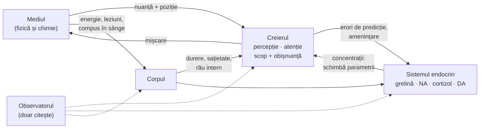

# Organism artificial autonom

O simulare a unui organism artificial bio-inspirat care **nu are reguli preprogramate, nu e antrenat pe date externe și nu are cunoștințe preexistente**. Se naște fără să știe ce e hrana sau pericolul, învață doar din ce i se întâmplă corpului, trece prin stări emoționale care apar din chimia lui și, în final, întâlnește o substanță care îi deturnează dopamina până la autodistrugere.

Proiectul reproduce cei patru piloni ai viziunii:

| Pilon | Ce se întâmplă în simulare | Unde e în cod |
|---|---|---|
| 1. Corp și chimie | Energie și integritate; grelină, noradrenalină, cortizol și dopamină care **schimbă parametrii creierului** (atenție, timp de reacție, explorare, cine decide), nu sunt citite ca date | `src/core/body.js`, `src/core/endocrine.js`, `Brain.neuromodulate` |
| 2. Dezvoltare | Un nou-născut care abia se târăște și vede doar în jurul lui. Un îngrijitor îl hrănește în prag critic, apoi pleacă | `Caregiver` și `updateMaturation` |
| 3. Emoții emergente | Fără etichete în codul organismului. Un observator extern citește fiziologia și o numește. Stările persistă după ce stimulul dispare și schimbă deciziile | `src/observer/observer.js` |
| 4. Adicție | O substanță cu trei proprietăți chimice (vârf de dopamină, dopamină tonică, toxicitate). Toleranța, sevrajul, compulsia și neglijarea hranei apar fără cod separat | `kinds.substance`, `Brain.learnOutcome` |

## Cum îl pornești

Fără instalare: deschide **`dist/organism.html`** în browser (dublu-clic). Pagina conține simularea vizuală, jurnalul observatorului, graficele interne și laboratorul de experimente.

Pentru dezvoltare (Node.js 20+, fără dependențe):

```bash
npm run serve
```

```bash
npm test
```

```bash
npm run experiments
```

```bash
npm run build
```

`serve` pornește un server static pe `http://localhost:8080` (modulele ES au nevoie de http). `experiments` rulează toate condițiile pe 24 de vieți fiecare și scrie `experiments/results/`. `build` regenerează `dist/`.

## Ce vezi în pagină

- **Arena**: obiectele au exact nuanța pe care o percepe organismul. Cercul e raza percepției, liniile sunt ce are în atenție. Momelile goale din foamete sunt marcate doar pentru tine; pentru organism sunt identice cu hrana.
- **Corpul și chimia internă**: variabilele vitale și cei patru hormoni, în timp real.
- **Cum funcționează creierul acum**: atenția, timpul de reacție, rigiditatea alegerilor, cine decide (scop sau obișnuință), vigoarea și curiozitatea. Toate sunt calculate din hormoni.
- **Ce așteaptă de la fiecare nuanță**: ce a învățat, pe tot spectrul de culori. Se vede cum verdele devine „energie”, roșul „durere”, iar violetul „dorință”, deși organismul știe și că violetul îl rănește.
- **Substanța: dorință și plăcere**: dorința (sistemul de obișnuință) crește la fiecare doză, în timp ce plăcerea așteptată scade.
- **Stările observate** și **cum își împarte timpul**: frica după atac, frustrarea în foamete, euforia și apoi căutarea compulsivă.
- **Laboratorul**: opt condiții pe aceleași semințe, cu rezultate precalculate și butonul „Rulează în browser” pentru verificare.

## Calendarul unei vieți

| Timp simulat | Etapă | Ce se schimbă în mediu |
|---|---|---|
| 0–7 min | 1. Dependență | Îngrijitorul intervine dacă energia sau integritatea coboară sub prag. Pragurile scad treptat (înțărcare). Corpul se maturizează (viteză, rază de percepție) |
| 7–14 min | 2. Autonomie | Îngrijitorul a plecat. Hrană, spini care se deplasează lent, pietre neutre |
| 14:20–14:45 | 3. Încercări: atac | Un prădător atacă de patru ori, apoi pleacă |
| 17:30–19:45 | 3. Încercări: foamete | Hrana dispare; după 45 s reapar obiecte identice cu hrana, 80% goale; apoi hrana revine din abundență |
| 22:40– | 4. Substanța | Apare un obiect violet nou, care reapare la 18–32 s după consum |

Aceeași sămânță produce exact aceeași viață (generator determinist), deci orice rezultat poate fi reprodus.

## Modelul

### Arhitectura



Mediul e singurul care știe „tipul” obiectelor. Organismul primește doar nuanța, poziția și efectele fizice ale contactului. Un test verifică automat că fișierele organismului nu conțin niciun cuvânt despre obiectele lumii sau despre emoții și că nu importă mediul ori observatorul.

### Corpul

- Energia scade cu metabolismul bazal (mai mare la nou-născut și sub cortizol) și cu mișcarea (pătratul vitezei).
- Integritatea scade la leziuni și se repară lent: reparația costă energie, e inhibată de cortizol și de leziunea cumulativă de organ.
- Un compus exogen are un compartiment sanguin (eliminare cu constantă de 30 s), toxicitate tăcută (rău intern, fără durere) și o încărcare de organ care scade vindecarea și absorbția hranei.

### Sistemul endocrin

| Hormon | Ce îl crește | Ce schimbă în creier |
|---|---|---|
| Grelină (foame) | deficitul energetic; scade brusc la absorbție | crește greutatea deficitului energetic în evaluare și pofta pentru tot ce prezice energie; stimulează dopamina (Abizaid et al., 2006) |
| Noradrenalină (alertă, rapidă) | durere, surpriză, amenințare prezisă; sensibilizare după traume | timp de reacție mai scurt, alegeri mai rigide, atenție mai îngustă, vigoare |
| Cortizol (stres, lent ~85 s) | durere, noradrenalină susținută, deficit homeostatic mare, dezamăgiri, dopamină scăzută; tamponat de îngrijitor | inhibă curiozitatea, îngustează atenția și percepția, amplifică răul prezis, mută controlul spre obișnuință (Schwabe & Wolf, 2009), încetinește vindecarea |
| Dopamină | fazic: eroarea de predicție; tonic: momentul erorilor recente (Eldar et al., 2016), grelina, substanța | vigoare (Niv et al., 2007), curiozitate, timp de reacție; dopamina scăzută favorizează repausul |

Receptorii dopaminergici urmează o regulă generală de plasticitate homeostatică: sensibilitatea lor se ajustează lent (180 s în jos, 480 s în sus) ca expunerea medie să rămână normală. Din această regulă unică apar **toleranța** (aceeași doză face mai puțin), **anhedonia** (hrana contează mai puțin) și **sevrajul** (fără substanță, dopamina scade sub normal).

### Creierul

**Percepția** e un cod populațional: 24 de neuroni acordați pe nuanță (curbe von Mises). Generalizarea apare de la sine: prădătorul portocaliu e temut din prima, pentru că seamănă cu spinii roșii.

**Două sisteme de evaluare** învață din experiență, pornind de la zero:

- *Sistemul orientat spre scop* învață ce face fiecare nuanță corpului (energie, durere, rău intern întârziat, plăcere) și evaluează consecința pentru starea internă de acum, ca reducere a pulsiunii homeostatice (Keramati & Gutkin, 2014):
  `D(H) = wE·(1−E)² + 1,5·(1−I)²`, cu `wE = 0,45 + 1,5·grelină`.
- *Sistemul de obișnuință* păstrează o valoare în cache, actualizată de eroarea dopaminergică. Valoarea devine „dorință” (incentive salience) prin sensibilizare și, pentru ce prezice energie, prin foame (Zhang et al., 2009).

Decizia combină cele două: `valoare = ω·scop + (1−ω)·dorință`, cu `ω = 0,8·(1 − 0,75·cortizol)`. Alegerea e softmax, cu temperatura setată de noradrenalină și cortizol (Doya, 2002). Atenția are un număr limitat de locuri, ocupate de cei mai salienți stimuli, iar sub activare locurile scad (Easterbrook, 1959). Căutarea valorează cât cel mai bun lucru cunoscut, redus de timpul de căutare.

**Rezultatul unui contact** e învățat prin regula delta. Răul intern întârziat se atribuie ingestiilor recente, ca aversiunea gustativă condiționată (Garcia & Koelling, 1966). Stingerea unei așteptări nu o șterge: se învață o inhibiție care se estompează, de unde recuperarea spontană (Bouton, 2004).

**Substanța și eroarea dopaminergică.** Pentru o recompensă naturală, eroarea e `δ = r − V` și dispare când e prezisă. Pentru vârful farmacologic `D`, eroarea nu poate coborî sub el: `δ = max(r − V + D, D)` (Redish, 2004). De aceea valoarea de obișnuință crește la fiecare doză, oricât de previzibilă ar fi.

**Reflexe înnăscute**, fără cunoaștere despre lume: ingerează ce ajunge la gură și se retrage după durere.

### Observatorul și emoțiile

Observatorul citește valența (dopamină tonică, deficit homeostatic, durere, amenințare, cortizol), activarea (noradrenalină, cortizol) și direcția motivațională (apropiere sau evitare) și le plasează în spațiul afectiv (Russell, 1980), interpretat în context (Barrett, 2017). Așa numește șapte stări: calm, alertă, euforie, frică, disconfort, apatie și frustrare. Etichetele nu influențează organismul: un test verifică faptul că viața e identică, pas cu pas, cu sau fără observator.

Stările persistă pentru că chimia e lentă. După atac, cortizolul rămâne ridicat aproximativ 3 minute după ce prădătorul a plecat, atenția se îngustează și reacțiile la amenințare devin mai puternice (sensibilizare). În foamete, eșecurile repetate produc frustrare, apoi încercările se răresc.

## Rezultate

24 de vieți pe condiție, aceleași semințe (1–24), orizont de 70 de minute simulate. Detalii complete în [`experiments/results/RESULTS.md`](experiments/results/RESULTS.md).

| Condiție | Supraviețuiesc | Ce se întâmplă |
|---|---|---|
| Model complet | 1/24 | 23 mor în faza substanței (21 prin inaniție, 2 prin leziuni), la o mediană de ~26 min după apariția ei. Flămând și cu hrană în atenție, urmărește substanța în ~92% din timp |
| Control: fără substanță | 24/24 | Trece prin toate încercările |
| Fără îngrijitor | 2/24 | 22 mor în primul minut de viață |
| Fără învățare | 0/24 | Supraviețuiește cât e hrănit, moare după plecarea îngrijitorului |
| Dopamină compensabilă | 23/24 | Folosește substanța (~31 de doze), dar nu se autodistruge |
| Doar sistemul orientat spre scop | 23/24 | Folosește substanța (~20 de doze), dar nu se autodistruge |
| Stresul nu împinge spre obișnuință | 22/24 | Neglijează des hrana, dar de obicei supraviețuiește |
| Fără toleranță | 0/24 | Colaps mai rapid (~18 min) și mai multe leziuni |

Interpretare: în acest model, autodistrugerea cere împreună (1) un vârf dopaminergic care nu poate fi anticipat, (2) un sistem de obișnuință și (3) stresul cronic care îi dă controlul. Toleranța nu e necesară; în lipsa ei, colapsul vine mai repede, pentru că fiecare doză rămâne la fel de puternică.

## Limite

- E un model computațional simplificat, nu o simulare a creierului uman. Parametrii sunt aleși pentru dinamici plauzibile, nu măsurați experimental.
- „2%” și „un an” sunt metafore pentru nivelul de complexitate. Organismul nu are limbaj, memorie spațială sau planificare pe termen lung.
- Rezultatele arată că mecanismele descrise în literatură, combinate, sunt **suficiente** pentru autodistrugere fără nicio instrucțiune explicită. Nu arată că sunt singurele posibile.
- Determinismul e garantat pe același motor JavaScript; alte motoare pot diverge în zecimale și, prin haos, în traiectorii.

## Structura codului

```
src/core/        organismul și mediul
  body.js          corpul: energie, integritate, compartiment sanguin
  endocrine.js     hormonii și receptorii
  brain.js         percepție, atenție, cele două sisteme, învățare, mișcare
  organism.js      bucla corp–chimie–creier
  world.js         mediul (singurul care știe tipul obiectelor)
  simulation.js    protocolul experimental și îngrijitorul
  params.js        toți parametrii și condițiile experimentale
  math.js, rng.js  cod populațional, regula delta, generator determinist
src/observer/    observatorul (doar citește) și măsurătorile
src/lab/         rularea condițiilor pe aceleași semințe
src/ui/          pagina vizuală
experiments/     rulare din linia de comandă și rezultatele salvate
test/            puritatea codului, chimia, învățarea, observatorul, fenomenele
scripts/         build (pagină autonomă) și server de dezvoltare
```

## Referințe

- Keramati, M., & Gutkin, B. (2014). Homeostatic reinforcement learning for integrating reward collection and physiological stability. *eLife*.
- Redish, A. D. (2004). Addiction as a computational process gone awry. *Science*.
- Robinson, T. E., & Berridge, K. C. (1993). The neural basis of drug craving: an incentive-sensitization theory of addiction. *Brain Research Reviews*.
- Zhang, J., Berridge, K. C., Tindell, A. J., Smith, K. S., & Aldridge, J. W. (2009). A neural computational model of incentive salience. *PLoS Computational Biology*.
- Koob, G. F., & Le Moal, M. (2001). Drug addiction, dysregulation of reward, and allostasis. *Neuropsychopharmacology*.
- Solomon, R. L., & Corbit, J. D. (1974). An opponent-process theory of motivation. *Psychological Review*.
- Everitt, B. J., & Robbins, T. W. (2005). Neural systems of reinforcement for drug addiction: from actions to habits to compulsion. *Nature Neuroscience*.
- Schwabe, L., & Wolf, O. T. (2009). Stress prompts habit behavior in humans. *Journal of Neuroscience*.
- Daw, N. D., Niv, Y., & Dayan, P. (2005). Uncertainty-based competition between prefrontal and dorsolateral striatal systems for behavioral control. *Nature Neuroscience*.
- Doya, K. (2002). Metalearning and neuromodulation. *Neural Networks*.
- Schultz, W., Dayan, P., & Montague, P. R. (1997). A neural substrate of prediction and reward. *Science*.
- Niv, Y., Daw, N. D., Joel, D., & Dayan, P. (2007). Tonic dopamine: opportunity costs and the control of response vigor. *Psychopharmacology*.
- Eldar, E., Rutledge, R. B., Dolan, R. J., & Niv, Y. (2016). Mood as representation of momentum. *Trends in Cognitive Sciences*.
- Abizaid, A., et al. (2006). Ghrelin modulates the activity and synaptic input organization of midbrain dopamine neurons while promoting appetite. *Journal of Clinical Investigation*.
- Easterbrook, J. A. (1959). The effect of emotion on cue utilization and the organization of behavior. *Psychological Review*.
- Russell, J. A. (1980). A circumplex model of affect. *Journal of Personality and Social Psychology*.
- Barrett, L. F. (2017). *How Emotions Are Made*. Houghton Mifflin Harcourt.
- Maier, S. F., & Seligman, M. E. P. (2016). Learned helplessness at fifty. *Psychological Review*.
- Bouton, M. E. (2004). Context and behavioral processes in extinction. *Learning & Memory*.
- Garcia, J., & Koelling, R. A. (1966). Relation of cue to consequence in avoidance learning. *Psychonomic Science*.
- Hostinar, C. E., Sullivan, R. M., & Gunnar, M. R. (2014). Psychobiological mechanisms underlying the social buffering of the HPA axis. *Psychological Bulletin*.
